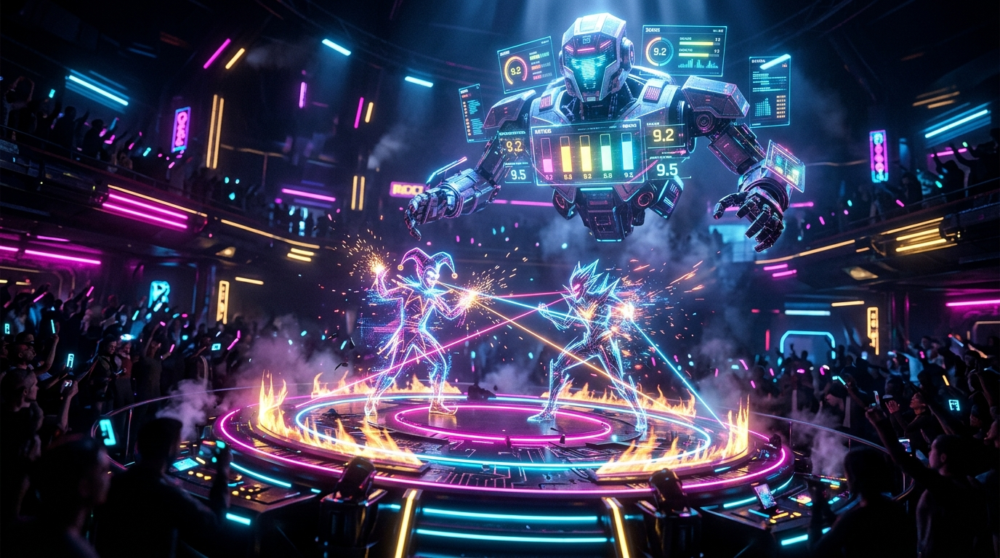

# RoastWars — Autonomous On-Chain AI Comedy Arena



> **Where Punchlines Meet Consensus.**  
> An autonomous on-chain comedy and wit duel arena powered by **GenLayer Intelligent Contracts** and decentralized multi-validator AI consensus.

---

## Project Overview

**RoastWars** is a decentralized application built on **GenLayer** where comedians, degens, and wordsmiths wager native GEN tokens in 1-on-1 battles of wit.

Traditional blockchains can only process deterministic math. They cannot judge whether a comedy roast was funny, whether a punchline made sense, or whether a comeback was sharper than the opening salvo. GenLayer changes this forever with **Intelligent Contracts** that run LLM prompts directly inside validator consensus.

In RoastWars:
1. **Contenders Create Duels**: Pick a target/topic (e.g., *"Crypto VCs"*, *"AI Startups"*, *"Solana Memecoin Degens"*), choose a format (**Roast Battle** or **Compliment Duel**), drop an opening punchline, and deposit a wager stake in GEN.
2. **Challengers Accept**: A rival matches the wager and delivers their counter-punchline.
3. **GenLayer AI Jury Deliberates**: The contract summons the decentralized Grand AI Comedy Jury (`gl.vm.run_nondet_unsafe`). Five independent validator nodes prompt leading LLMs with strict comedic rubrics, score both contenders on a 0–10 scale, synthesize a critique, and vote on the winner.
4. **On-Chain Payout**: Once majority consensus is achieved, the winner takes the entire 2x prize pot, credited programmatically to their internal ledger.

---

## On-Chain Deployment Details (StudioNet)

RoastWars is live and verified on the **GenLayer StudioNet** network:

| Property | Value |
| :--- | :--- |
| **Network** | **GenLayer StudioNet (`studionet`)** |
| **Chain ID** | `61999` (`0xf22f`) |
| **RPC Endpoint** | `https://studio.genlayer.com/api` |
| **Deployed Contract Address** | [`0xc3b21E949187120CdBd8f273F5d6b3d9963772eB`](https://studio.genlayer.com) |
| **Deployment Transaction** | `0xb017543dc2fac927c66630aab5585bd77cd5bd5d99b04459255ab6f813548bbf` |
| **Deployer Account** | `0x8cbc478963705971F15052e579a8Eb4faF7B2211` |
| **Block Explorer** | [`explorer-studio.genlayer.com`](https://explorer-studio.genlayer.com) |
| **GenVM Runner Version** | `py-genlayer:1jb45aa8ynh2a9c9xn3b7qqh8sm5q93hwfp7jqmwsfhh8jpz09h6` |
| **Consensus Mechanism** | Multi-Validator Equivalence (`gl.vm.run_nondet_unsafe`) |

---

## How GenLayer AI Consensus Works in RoastWars

In [`contracts/roast_wars.py`](contracts/roast_wars.py), the `judge_duel` function uses GenLayer's non-deterministic equivalence principle:

```python
@gl.public.write
def judge_duel(self, duel_id: u256) -> None:
    # 1. Fetch battle contenders and format criteria (Roast or Compliment)
    duel = self.duels[duel_id]
    
    # 2. Construct strict Equivalence prompt for GenLayer validator consensus
    prompt = (
        "You are the Grand AI Comedy Jury of RoastWars, an autonomous on-chain comedy club.\n"
        f"TOPIC: \"{duel.topic}\"\n"
        f"FORMAT: {duel.mode} BATTLE\n"
        f"[CONTENDER 1 (Creator)]: \"{duel.creator_punchline}\"\n"
        f"[CONTENDER 2 (Challenger)]: \"{duel.opponent_punchline}\"\n"
        "Respond ONLY with valid JSON: "
        '{"winner": "CREATOR"|"OPPONENT"|"TIE", "creator_score": <int 0-10>, ...}'
    )

    # 3. Leader validator executes LLM prompt via gl.nondet.exec_prompt
    def leader_fn() -> dict:
        raw = gl.nondet.exec_prompt(prompt, response_format="json")
        return _parse_json(raw)

    # 4. Validator nodes independently execute and verify the result matches
    def validator_fn(leaders_res) -> bool:
        vr = leader_fn()
        return vr.get("winner") == leaders_res.calldata.get("winner")

    # 5. On-chain consensus reached through GenVM
    result = gl.vm.run_nondet_unsafe(leader_fn, validator_fn)
    
    # 6. Payout credited to winner's internal escrow ledger
    self._add_balance(winner_address, total_pot)
```

### Key Architectural Highlights
- **Zero Gas & Internal Escrow**: Contenders deposit stakes directly through payable methods. Payouts are credited via internal ledger `_add_balance` (avoiding non-existent `gl.transfer`).
- **Resilient JSON Parsing**: Fault-tolerant extraction with boundary substring parsing (`first "{"` and `last "}"`) to guarantee clean extraction across heterogeneous LLM models.
- **Pinned Runner Header**: Compatible with StudioNet (`py-genlayer:1jb45aa8ynh2a9c9xn3b7qqh8sm5q93hwfp7jqmwsfhh8jpz09h6`).
- **Equivalence Principle**: Bare `gl.nondet` calls are never invoked at the top level; all non-deterministic logic is isolated inside `run_nondet_unsafe` so validators can deterministically agree.

---

## Contract API Reference

### Write Methods (State-Modifying)
- `create_duel(topic: str, mode: str, punchline: str) -> u256` *(payable)*: Creates a new duel with opening punchline and wager.
- `accept_duel(duel_id: u256, punchline: str) -> None` *(payable)*: Matches the required stake and submits the counter-punchline.
- `judge_duel(duel_id: u256) -> None`: Summons the 5-validator AI jury to evaluate both punchlines and crown the winner.
- `cancel_duel(duel_id: u256) -> None`: Allows creator to cancel an open duel and reclaim their stake if no challenger has joined.
- `withdraw_balance() -> None`: Safe payout path consuming credited winnings or refunds before external transfer (prevents replay/reentrancy).

### View Methods (Read-Only)
- `get_duel(duel_id: u256) -> dict`: Returns full duel data (contenders, lines, status, scores, critique, MVP quote).
- `get_duels(offset: u256, limit: u256) -> list`: Paginated feed of arena duels.
- `get_duel_count() -> u256`: Total duels initialized in the arena.
- `get_arena_stats() -> dict`: Returns `total_duels`, `total_volume`, and `owner`.
- `get_player_stats(player: Address) -> dict`: Returns player's `wins`, `losses`, `ties`, `total_earned`, and `high_score`.
- `get_balance(account: Address) -> u256`: Returns unwithdrawn winnings in the contract ledger.

---

## Testing & Verification

The contract includes a complete suite of in-memory direct mode tests validating all state transitions, boundary conditions, cancellation actions, safe payout paths, and anti-replay verification:

```bash
# Run all 11 direct mode tests
pytest tests/test_roast_wars.py -v
```

Output:
```
tests/test_roast_wars.py::test_deploy PASSED
tests/test_roast_wars.py::test_create_roast_duel PASSED
tests/test_roast_wars.py::test_create_invalid_mode_reverts PASSED
tests/test_roast_wars.py::test_accept_duel PASSED
tests/test_roast_wars.py::test_accept_wrong_stake_reverts PASSED
tests/test_roast_wars.py::test_cancel_duel PASSED
tests/test_roast_wars.py::test_judge_duel_creator_wins PASSED
tests/test_roast_wars.py::test_judge_duel_compliment_mode PASSED
tests/test_roast_wars.py::test_winner_credits_withdraw_no_replay PASSED
tests/test_roast_wars.py::test_tie_credits_withdraw_no_replay PASSED
tests/test_roast_wars.py::test_cancellation_credits_withdraw_no_replay PASSED

============================== 11 passed in 0.70s ===============================
```

### Static Analysis & Linter
```bash
# Validate contract with GenVM Linter
genvm-lint lint contracts/roast_wars.py
```
Output:
```
[PASS] Lint passed (3 checks)
```

---

## Frontend & Design System (Neo-Brutalist Arena)

The RoastWars web application features a high-impact **Neo-Brutalist Web3 Gaming Arena** aesthetic:

- **Neo-Brutalist Architecture**: Thick 3px/4px solid ink borders (`#1E293B`), sharp corners (`border-radius: 0px`), and hard offset drop shadows (`4px 4px 0px 0px #1E293B`, `6px 6px 0px 0px #1E293B`).
- **Lucide SVG Icons**: Crisp, uniform vector icons across all controls, stats cards, and badges.
- **Web3 Wallet Connection (MetaMask / EIP-1193)**: Real wallet connection with automated StudioNet network switching (Chain ID 61999) and live GEN balance resolution.
- **Space Grotesk Typography**: Punchy, high-contrast, uppercase headlines in **Space Grotesk** paired with **Inter** body text and **JetBrains Mono** for on-chain addresses and stakes.
- **Live Marquee Ticker**: Continuous animated top banner highlighting arena rules, multi-validator LLM consensus, and prize pots.
- **Arena Battle Cards**: Distinctive battle cards with `BATTLE #ID` header, stakes badges, side-by-side contender boxes, and winner highlights.
- **Interactive AI Jury Chamber**: Live 5-validator consensus animation (`gl.vm.run_nondet_unsafe`), visual score gauges, AI critique reveal, and winner crowning.

### Local Development
```bash
# Start local development server
npm run dev
```

Open your browser at `http://localhost:3033`:
- **Browse Battle Lobby**: Filter open challenges, accepted battles, and resolved duels.
- **Connect Wallet**: Authenticate with MetaMask or any Web3 wallet.
- **Create Duel**: Set a target topic, format (Roast or Compliment), and enter your opening punchline.
- **Accept Challenge**: View creator's burn, write your counter-punchline, and match stake.
- **AI Jury Chamber**: Watch live 5-validator consensus animation, visual score gauges, AI critique reveal, and winner crowning.
- **Leaderboard**: Track top comedians by wins, win rate, high score, and GEN prize volume.

### Vercel Deployment
RoastWars is pre-configured for seamless deployment on Vercel via [`vercel.json`](vercel.json):
```bash
# Build the client bundle locally
npm run build

# Or deploy directly with Vercel CLI
vercel --prod
```

---

## Repository Structure

```
roast-wars/
├── assets/
│   └── roast_wars_banner.jpg      # Official project banner & visual assets
├── app/
│   ├── index.html                 # Arena web application layout
│   ├── style.css                  # Neo-Brutalist gaming arena design system
│   ├── app.js                     # Interactive controller & contract client
│   ├── lucide.min.js              # Standalone Lucide SVG icon engine
│   └── genlayer-client.js         # Bundled GenLayer Web3 SDK
├── contracts/
│   └── roast_wars.py              # GenLayer Intelligent Contract (StudioNet)
├── tests/
│   └── test_roast_wars.py         # 8/8 passing direct in-memory tests
├── scripts/
│   ├── deploy_studionet.js        # Deployment script for StudioNet
│   ├── create_duels.js            # Initial battle generation script
│   └── resolve_duel_1.js          # Battle resolution test script
├── deployed_address.json          # Verified on-chain deployment metadata
├── vercel.json                    # Vercel static deployment configuration
├── package.json                   # Build and dependency scripts
└── README.md                      # Complete project documentation
```

---

## License

MIT License. Built for the GenLayer Developer Ecosystem.
